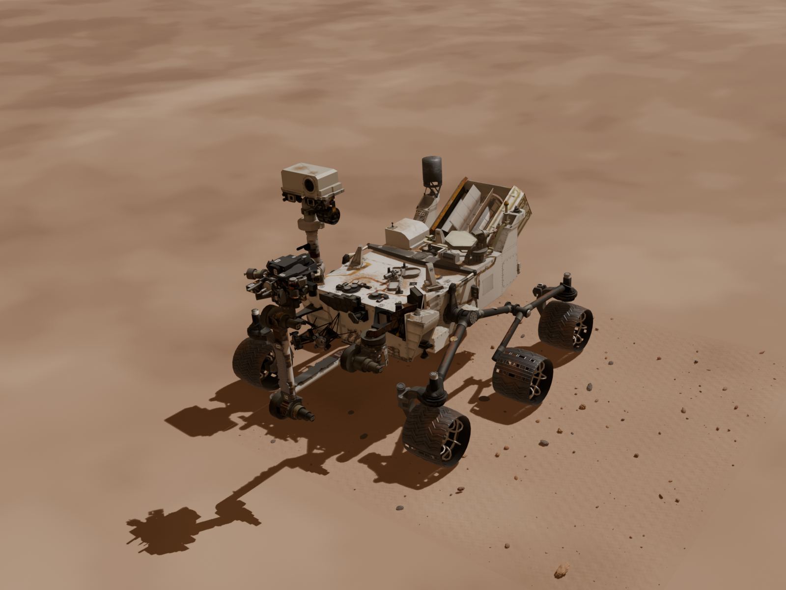
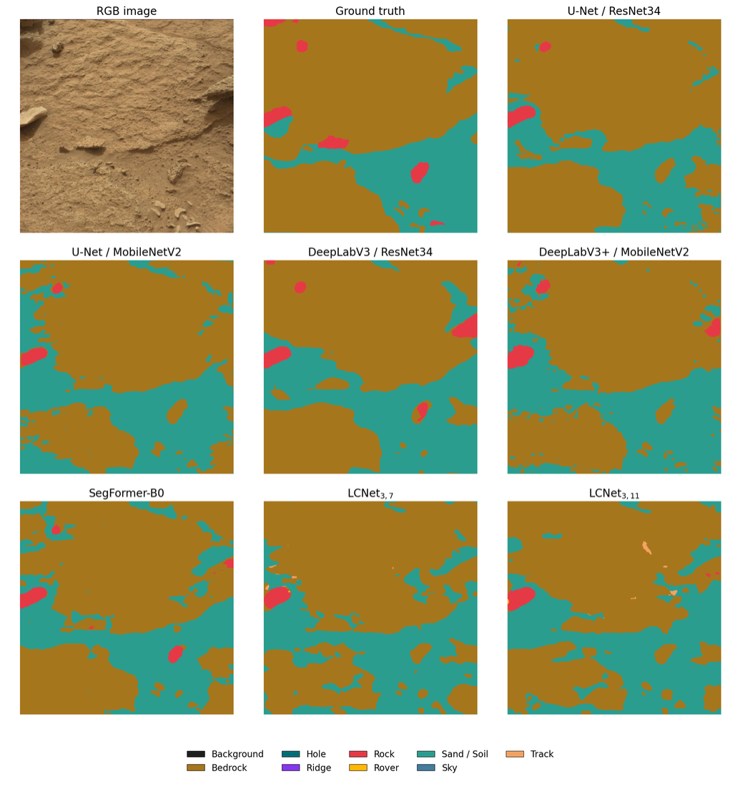
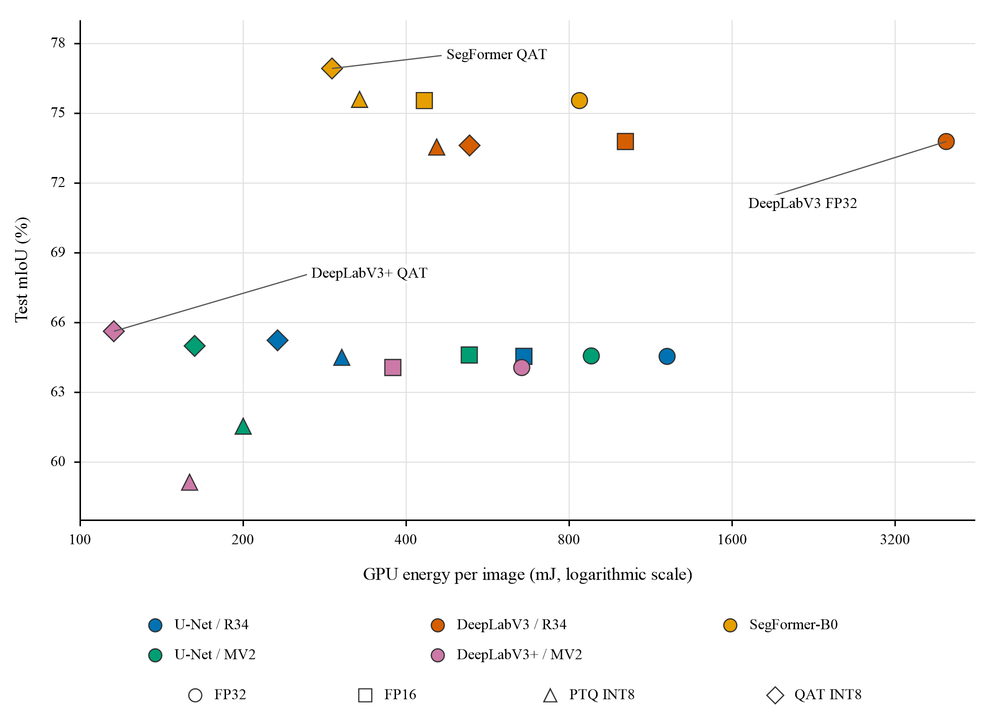
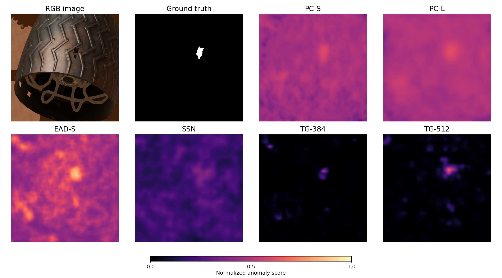

<h1 align="center">Visual Perception for Martian Rovers</h1>

<p align="center">
  <strong>Lightweight Scene Understanding and<br>Synthetic Data-Driven Damage Inspection for Martian Rovers</strong>
</p>

<p align="center">
  Master's thesis &middot; Daniele Venturini &middot; Sapienza University of Rome
</p>

<p align="center">
  <a href="thesis/latex/Lightweight%20Scene%20Understanding%20and%20Synthetic%20Data-Driven%20Damage%20Inspection%20for%20Martian%20Rovers.pdf">Thesis</a>
  &nbsp;&middot;&nbsp;
  <a href="thesis/latex/Lightweight%20Scene%20Understanding%20and%20Synthetic%20Data-Driven%20Damage%20Inspection%20for%20Martian%20Rovers.tex">LaTeX source</a>
  &nbsp;&middot;&nbsp;
  <a href="https://www.kaggle.com/datasets/dalphan01/curiosity-wheel-anomaly-detection">Dataset on Kaggle</a>
</p>

<p align="center">
  <a href="#objective">Overview</a> &middot;
  <a href="#method">Method</a> &middot;
  <a href="#public-synthetic-dataset">Dataset</a> &middot;
  <a href="#main-results">Results</a> &middot;
  <a href="#repository-guide">Code</a> &middot;
  <a href="#what-to-run">Get started</a>
</p>

<p align="center">
  <a href="thesis/latex/Images/rover_terrain_overview_v2.png">
    
  </a>
  <br>
  <sub>The Curiosity scene used to generate the synthetic wheel-inspection dataset.</sub>
</p>

Research code for two complementary visual tasks: interpreting the surrounding
terrain and inspecting visible wheel damage. Both studies compare prediction
quality with the computational cost of future onboard perception.

| Terrain segmentation | Synthetic wheel dataset | Wheel damage detection |
| :---: | :---: | :---: |
| **76.93% test mIoU** | **10,000 annotated images** | **86.43% image AUROC** |
| SegFormer-B0 &middot; QAT | Six Curiosity wheels | PatchCore Large &middot; pose A |

## Objective

Future onboard perception should provide useful terrain and vehicle-condition
information within limited computing and energy budgets. This work studies:

- **Scene understanding:** assign semantic labels to rover images to support
  terrain interpretation and, eventually, navigation decisions.
- **Wheel inspection:** detect observations containing visible perforations
  and localize the damaged regions, using models trained on normal wheels.

The two branches have independent datasets, implementations and evaluations.
Their eventual integration into a common rover perception pipeline remains
future work.

## Method

### Lightweight semantic segmentation

Seven configurations are compared on the Mars-Bench release of **S5Mars**:
U-Net with ResNet34 or MobileNetV2, DeepLabV3 with ResNet34, DeepLabV3+ with
MobileNetV2, SegFormer-B0, and LCNet3_7 / LCNet3_11. Images are processed at
512 x 512 pixels, with a combined Cross-Entropy and Generalized Dice objective.

The study evaluates segmentation accuracy alongside latency, GPU memory and
energy per image. Deployment experiments compare FP32, FP16, Post-Training
Quantization (PTQ) and Quantization-Aware Training (QAT). Separate models
trained on **MarsSeg MSL and MER** assess transfer between Curiosity and
Spirit/Opportunity imagery without target-mission fine-tuning.

<details>
<summary><strong>See terrain segmentation predictions</strong></summary>

<p align="center">
  <a href="thesis/latex/Images/s5mars_model_prediction_comparison.png">
    
  </a>
</p>

*Qualitative FP32 comparison from the thesis: RGB input, ground truth and seven
model predictions, all using the same class colors.*

</details>

### Synthetic wheel-damage inspection

A Blender pipeline renders the six wheels of a Curiosity model, varying camera
viewpoint, wheel rotation, illumination and benign surface wear. Localized
through-holes define the anomaly class. Each damaged evaluation image has a
matching normal image with the same acquisition and appearance parameters.
Wheel and damage masks are generated automatically, and paired observations
remain in the same dataset split.

Four anomaly-detection families are adapted to this task: **PatchCore,
EfficientAD-S, SuperSimpleNet and TinyGLASS**. Training uses normal renders;
validation and test include normal and damaged observations. Image-level
metrics measure damage discrimination, while pixel-level metrics measure
localization. The main comparison uses the overhead camera view, pose A,
with wheel-focused preprocessing.

## Public synthetic dataset

**[Curiosity Wheel Anomaly Detection on Kaggle](https://www.kaggle.com/datasets/dalphan01/curiosity-wheel-anomaly-detection)**
contains 10,000 RGB PNG images at 1200 x 900 pixels, 10,000 target-wheel masks,
1,250 damage masks and a `samples.csv` manifest.

| Split | Normal images | Perforated images | Total |
| --- | ---: | ---: | ---: |
| Training | 7,000 | 0 | 7,000 |
| Validation | 750 | 250 | 1,000 |
| Test | 1,000 | 1,000 | 2,000 |
| **Total** | **8,750** | **1,250** | **10,000** |

Validation contains 250 matched normal/damaged pairs plus 500 standalone
normal images; test contains 1,000 matched pairs. Normal appearance can include
dust, scratches and cosmetic wear. Preserve the supplied splits and pair
assignments when comparing experiments.

## Main results

The following results come from Chapters 5 and 6 of the dissertation.
They describe the recorded experiments; current presets can use different
training budgets, crops and memory-bank sizes.

### Segmentation

Selected S5Mars test results and inference measurements:

| Configuration | Test mIoU | Latency (ms/image) | GPU energy (mJ/image) |
| --- | ---: | ---: | ---: |
| SegFormer-B0, FP32 | 75.55% | 11.88 | 835.72 |
| **SegFormer-B0, QAT INT8** | **76.93%** | 5.66 | 291.76 |
| **DeepLabV3+ / MobileNetV2, QAT INT8** | 65.63% | **3.01** | **115.34** |

QAT SegFormer-B0 achieves the highest measured test mIoU, while QAT
DeepLabV3+ / MobileNetV2 has the lowest measured GPU energy per image.
QAT includes supervised fine-tuning and distillation. INT8 denotes selective
mixed-precision execution, including convolution-only quantization for
SegFormer-B0.

In the separate MarsSeg study, SegFormer-B0 transfers better than the tested
CNNs in both directions: **52.06% mIoU from MSL to MER** and **48.11% from MER
to MSL**, although both remain below models trained on the target mission.

<p align="center">
  <a href="thesis/latex/Images/quantization_miou_energy.png">
    
  </a>
</p>

*Accuracy and GPU energy across the evaluated deployments. Higher is better
for mIoU; lower is better for energy. The energy axis uses a logarithmic scale.*

### Wheel inspection

Selected results on the **808-image pose-A test subset**. AP denotes Average
Precision; image AUROC measures the ranking of normal and damaged images.

| Configuration | Image AUROC | Pixel AP | Latency (ms/image) | GPU energy (J/image) |
| --- | ---: | ---: | ---: | ---: |
| **PatchCore Large (PC-L)** | **86.43%** | **42.89%** | 62.89 | 4.116 |
| SuperSimpleNet | 82.72% | 19.10% | 27.54 | 1.939 |
| **TinyGLASS, 384 px (TG-384)** | 77.52% | 25.48% | **5.13** | **0.239** |

PC-L provides the strongest image discrimination in the full comparison.
TG-384 has the lowest measured latency, GPU energy and peak allocated GPU
memory, at **38.72 MiB**. Detection and localization show different rankings:
for example, TG-384 has higher Pixel AP than SuperSimpleNet despite its lower
Image AUROC.

<p align="center">
  <a href="thesis/latex/Images/damage_model_prediction_comparison.png">
    
  </a>
</p>

*The same damaged observation evaluated by six configurations. The ground-truth
mask identifies the perforation; model maps show normalized anomaly scores.*

Resource measurements use an **NVIDIA T4 GPU**, batch size one, with inputs
already on the device. GPU energy includes device idle consumption and
excludes CPU processing, preprocessing and input transfers. Wheel results
concern synthetic images of one Curiosity asset; transfer to real imagery
and performance on rover hardware remain to be validated.

## Repository guide

| Path | Contents |
| --- | --- |
| [`semantic_segmentation/src/`](semantic_segmentation/src/) | Dataset loading, segmentation models, training, evaluation and quantization. |
| [`semantic_segmentation/configs/`](semantic_segmentation/configs/) | Dataset, model, training and PTQ/QAT settings. |
| [`semantic_segmentation/notebooks/`](semantic_segmentation/notebooks/) | Self-contained Kaggle training, PTQ, QAT and qualitative-comparison workflows. |
| [`semantic_segmentation/scripts/`](semantic_segmentation/scripts/) | Dataset inspection and notebook/configuration checks. |
| [`wheel_anomaly_detection/src/anomaly_detection/`](wheel_anomaly_detection/src/anomaly_detection/) | Anomaly models, preprocessing, training and evaluation. |
| [`wheel_anomaly_detection/configs/`](wheel_anomaly_detection/configs/) | ML presets and retained Blender dataset-generation configurations. |
| [`wheel_anomaly_detection/scripts/anomaly_detection/`](wheel_anomaly_detection/scripts/anomaly_detection/) | Local data inspection and experiment entrypoints. |
| [`wheel_anomaly_detection/notebooks/`](wheel_anomaly_detection/notebooks/) | Self-contained PatchCore and multi-model Kaggle workflows. |
| [`thesis/`](thesis/) | LaTeX chapters, compiled PDF, figures and presentation materials. |

Reusable generation logic also remains under `wheel_anomaly_detection/src/`.
The complete Blender orchestration scripts, original 3D/terrain assets and
prepared scenes are excluded from Git. Use the public rendered dataset to
run the inspection experiments from a fresh clone.

## What to run

### On Kaggle

The notebooks include their required implementation and can run without a
repository checkout.

| Task | Notebook |
| --- | --- |
| Train and evaluate segmentation models | [Segmentation training](semantic_segmentation/notebooks/kaggle_segmentation_training.ipynb) |
| Compare floating-point and PTQ deployments | [ONNX PTQ](semantic_segmentation/notebooks/kaggle_s5mars_onnx_ptq.ipynb) |
| Run quantization-aware training | [ModelOpt QAT](semantic_segmentation/notebooks/kaggle_s5mars_onnx_qat.ipynb) |
| Compare segmentation predictions from supplied checkpoints | [Qualitative comparison](semantic_segmentation/notebooks/kaggle_s5mars_qualitative_comparison.ipynb) |
| Run PatchCore wheel inspection | [PatchCore workflow](wheel_anomaly_detection/notebooks/kaggle_wheel_anomaly_detection.ipynb) |
| Compare all four anomaly-detection families | [Multi-model workflow](wheel_anomaly_detection/notebooks/kaggle_wheel_anomaly_detection_model_roadmap.ipynb) |

Open the selected notebook in Kaggle, enable Internet and select a GPU.
Review the configuration cell to select the dataset/model, then run the cells
in order. For wheel inspection, attach the public dataset above and set
`DRIVE_UPLOAD_ENABLED=False` to save outputs only in Kaggle. The multi-model
wheel notebook currently enables Drive upload by default. Segmentation
datasets are loaded from their configured Hugging Face repositories.

PTQ, QAT and qualitative comparison require compatible trained checkpoints,
which are not bundled. EfficientAD-S also requires teacher weights and
authenticated ImageNet-1k access, configured through `HF_TOKEN`. Optional
Drive operations require your own credentials and accessible destinations.

### Local workflows

Use a separate Python environment for each project. The examples below use
PowerShell; on Linux/macOS activate a virtual environment with
`source .venv/bin/activate`.

<details>
<summary><strong>Semantic segmentation: setup, training and mission transfer</strong></summary>

Start from the repository root:

```powershell
cd semantic_segmentation
python -m venv .venv
.\.venv\Scripts\Activate.ps1
python -m pip install -r requirements.txt

# Inspect a small S5Mars sample.
python scripts/analyze_dataset.py analysis.max_samples=5 visualization.num_samples=2 dataloader.num_workers=0

# Train and evaluate SegFormer-B0 on S5Mars.
python -m src.train.train_segmentation model=segformer_b0
```

Change the architecture through `model=...` and edit
[`configs/train/segmentation.yaml`](semantic_segmentation/configs/train/segmentation.yaml)
for the dataset, epochs and other settings. With no model override, the
checked-in preset selects LCNet3_7 for 30 epochs. A MarsSeg transfer run uses:

```powershell
python -m src.train.train_segmentation model=segformer_b0 dataset_name=marsseg_msl run_cross_dataset_evaluation=true
```

</details>

<details>
<summary><strong>Segmentation quantization: PTQ and QAT</strong></summary>

Run from `semantic_segmentation/` with its environment active. Install
`requirements-quantization.txt` and configure the model, checkpoint locations
and stage flags in
[`configs/quantization/`](semantic_segmentation/configs/quantization/), then
run the selected workflow:

```powershell
python -m pip install -r requirements-quantization.txt
python -m src.quantization.ptq
# Or, for QAT (requires CUDA):
python -m src.quantization.qat
```

The current PTQ preset enables FP32/FP16 benchmarking; enable its INT8 and
hold-out test stages explicitly for a full quantization experiment.

</details>

<details>
<summary><strong>Wheel inspection: setup, dataset check and experiments</strong></summary>

From the repository root, create a separate environment and extract the Kaggle
dataset. Change `$wheelDataset` below to the directory containing `samples.csv`,
`images/` and `masks/`.

```powershell
cd wheel_anomaly_detection
python -m venv .venv
.\.venv\Scripts\Activate.ps1
python -m pip install -r requirements/anomaly_detection.txt
$wheelDataset = "D:/datasets/curiosity-wheel-anomaly-detection"

# Check one batch from each split before a full experiment.
python scripts/anomaly_detection/inspect_dataloaders.py "dataset.root=$wheelDataset" dataloader.num_workers=0

# Fit and evaluate the default PatchCore preset.
python scripts/anomaly_detection/run_experiment.py "dataset.root=$wheelDataset"

# Or select the TinyGLASS pose-A experiment.
python scripts/anomaly_detection/run_experiment.py "dataset.root=$wheelDataset" model=tinyglass +experiment=tinyglass_pose_a
```

The [base configuration](wheel_anomaly_detection/configs/anomaly_detection/config.yaml)
selects `A_overhead`; `dataset.camera_poses=null` includes all camera poses.
Model-specific input geometry and training settings live in
[`configs/anomaly_detection/model/`](wheel_anomaly_detection/configs/anomaly_detection/model/).
Keep ML dependencies in the host environment; Blender uses its bundled Python.

</details>

Local results are saved under each project's `outputs/` directory; Kaggle
results are saved under `/kaggle/working/`. Datasets, trained checkpoints,
original assets and runtime logs are excluded from Git. See the
[thesis build instructions](thesis/README.md#building-the-dissertation) to
compile the LaTeX sources.

## License and attribution

A project-wide open-source license has not been specified. The bundled
Sapthesis class retains its [upstream license and attribution notice](thesis/latex/README).
Third-party datasets, model weights, illustrations and presentation materials
retain their respective terms and attribution.
