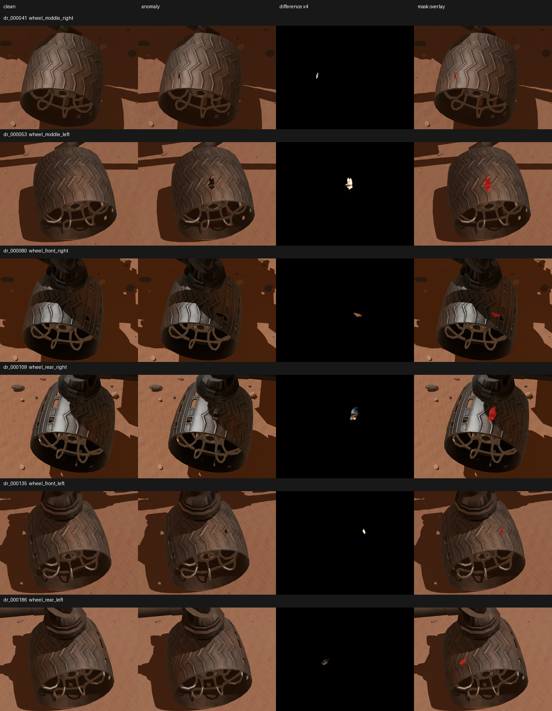

# Curiosity Wheel Anomaly Detection

Synthetic dataset generation and visual anomaly detection for Curiosity rover
wheels. A controlled Blender scene produces clean images and matched images
with synthetic perforations. Models learn from clean images and are evaluated
for image-level detection and pixel-level localization.



## Dataset

The completed synthetic dataset contains:

| Content | Count |
| --- | ---: |
| RGB images | 10,000 |
| Target-wheel masks | 10,000 |
| Hole-anomaly masks | 1,250 |
| Training images, clean only | 7,000 |
| Validation images | 1,000 |
| Test images | 2,000 |

Clean/anomalous evaluation pairs share the scene and imaging conditions.
Original assets, the dataset and trained checkpoints are not included in Git.

To run the ML workflows, supply an extracted dataset with `samples.csv` at
its root and all image/mask paths referenced by that manifest. The configured
split names are `train`, `validation` and `test`. The notebook workflow also
expects `images/` and `masks/` directories.

The local canonical dataset path, when prepared, is
`outputs/anomaly_detection_2/datasets/curiosity_wheel_hole_v1_10000`.
Generation, pairing, photometric gates and provenance are documented in the
[generation index](docs/generation/INDEX.md) and
[final dataset assembly](docs/generation/final_dataset_assembly.md).

## Installation

From the repository root:

```bash
cd wheel_anomaly_detection
python -m venv .venv
```

Activate the environment for your shell:

```powershell
.\.venv\Scripts\Activate.ps1
```

```bash
source .venv/bin/activate
```

Install [the ML dependencies](requirements/anomaly_detection.txt):

```bash
python -m pip install -r requirements/anomaly_detection.txt
```

Rendering uses Blender's bundled Python. Install
[the host generation dependencies](requirements/generation.txt) when working
on scene preparation or dataset generation:

```bash
python -m pip install -r requirements/generation.txt
```

Keep ML packages outside Blender's Python environment. Generation also
requires the original NASA GLB, HiRISE terrain products and derived Blender
scenes described in the generation documents. The current render
configurations target Blender 5.2 and Eevee.

## Quick start

Run these commands from `wheel_anomaly_detection/`. Replace the example
dataset path with your extracted dataset location; quote the override if it
contains spaces.

Inspect one batch from each split:

```bash
python scripts/anomaly_detection/inspect_dataloaders.py dataset.root=/path/to/curiosity_wheel_hole_v1_10000 dataloader.num_workers=0
```

Run the default PatchCore preset:

```bash
python scripts/anomaly_detection/run_experiment.py dataset.root=/path/to/curiosity_wheel_hole_v1_10000
```

Select another model or an experiment preset:

```bash
python scripts/anomaly_detection/run_experiment.py dataset.root=/path/to/curiosity_wheel_hole_v1_10000 model=tinyglass +experiment=tinyglass_pose_a
```

The [base configuration](configs/anomaly_detection/config.yaml) currently
selects `A_overhead` images. Use `dataset.camera_poses=null` to include all
poses. Input size, crop and normalization depend on the selected model.

Pretrained backbones may download weights on first use. EfficientAD training
also requires its teacher weights and authenticated ImageNet-1k access;
see [its configuration](configs/anomaly_detection/model/efficientad_s.yaml).
Results are saved under `outputs/anomaly_detection/`.

## Models and recorded results

Implemented model families are PatchCore, EfficientAD-S, TinyGLASS and
SuperSimpleNet. Their [model presets](configs/anomaly_detection/model/)
and [evaluation contract](docs/anomaly_detection/evaluation.md) define
preprocessing, optimization and metrics.

The table summarizes recorded overhead-view test runs. These values belong
to the stated experiments; running the current defaults does not imply
reproducing those runs.

| Recorded run | Image AUROC | Image AP | Pixel AUROC | Pixel AP |
| --- | ---: | ---: | ---: | ---: |
| PatchCore Light, bank 50k, crop 720 | 0.79283 | 0.77494 | 0.99783 | 0.41054 |
| PatchCore Reference, bank 50k, crop 720 | 0.86428 | 0.88631 | 0.99429 | 0.42891 |
| EfficientAD-S, global max, fixed 70k steps | 0.66502 | 0.64737 | 0.96365 | 0.09004 |
| TinyGLASS, 384 px, layer2, sigma 1 | 0.77523 | 0.79281 | 0.97213 | 0.25476 |
| TinyGLASS, 512 px, layer3, sigma 4 | 0.77330 | 0.81126 | 0.97924 | 0.27592 |
| SuperSimpleNet, Perlin 0.2, wheel-restricted | 0.83133 | 0.86214 | 0.97317 | 0.16779 |

Input resolution and observed pixel regions differ between runs, especially
for the PatchCore Reference center crop. Pixel AP therefore needs the
preprocessing context. Full settings, validation results, variants and
limitations are recorded in [the experiment history](docs/anomaly_detection/experiment_history.md).

## Kaggle

Two self-contained notebooks remain in [the notebook directory](notebooks/README.md):
a PatchCore workflow and a multi-model workflow. They include the required
implementation and do not import repository source packages on Kaggle.

Attach the extracted dataset and review each configuration cell. The
multi-model notebook currently selects SuperSimpleNet on pose A and has
Drive upload enabled; set `DRIVE_UPLOAD_ENABLED=False` when using it without
your own Drive configuration.

## Repository layout

```text
assets/original/             Local immutable source asset
configs/anomaly_detection/   ML and experiment presets
configs/blender/             Dataset-generation contracts
docs/anomaly_detection/      Evaluation and experimental records
docs/generation/             Dataset provenance and scene milestones
notebooks/                   Self-contained Kaggle workflows
scripts/anomaly_detection/   ML entrypoints
scripts/blender/             Blender-side generation and validation
scripts/host/                Host orchestration and validation
src/anomaly_detection/       Models, data loading, training and evaluation
src/                        Pure generation logic
```

## Verification and limitations

The current checkout has no `tests/` directory. Use the dataloader inspection
above for a data/preprocessing check. Scene and batch validators are described
in the [generation guide](docs/generation/README.md); required render QA
includes visual inspection.

Synthetic test results do not establish performance on real rover imagery.
The dataset focuses on perforations; the separate real-wheel pilot is
documented in [its research record](docs/anomaly_detection/real_zero_shot_pilot.md).

## Documentation

- [Anomaly-detection guide](docs/anomaly_detection/README.md)
- [Dataset and preprocessing](docs/anomaly_detection/dataloader.md)
- [Evaluation protocol](docs/anomaly_detection/evaluation.md)
- [Complete experiment history](docs/anomaly_detection/experiment_history.md)
- [Generation pipeline index](docs/generation/INDEX.md)
- [Final dataset assembly](docs/generation/final_dataset_assembly.md)
